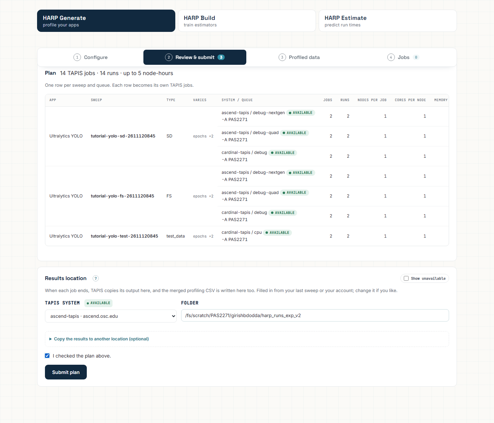

# HARP README content and screenshot plan

This authoring checklist tracks the work needed to keep HARP's repository README and ICICLE Training Catalog pages useful as the interface changes. It is not an end-user guide.

## Comparison with other ICICLE UI services

| Documentation area | HARP before this scaffold | Pattern used by comparable ICICLE UIs | Scaffold status |
|---|---|---|---|
| Product summary | Detailed technical overview | Short outcome-oriented introduction | Keep the overview; tighten after maintainers confirm final positioning |
| Try-before-use path | Offline demo mentioned in one sentence | Tutorial with prerequisites, steps, and expected result | Added |
| Hosted onboarding | URL and token flow only | Explicit prerequisites, authentication behavior, and expected screen | Added; TapisUI screenshot waits for integration approval |
| First workflow | Seven compressed steps | Small safe first run with observable results at every stage | Expanded |
| Screenshots | Existing assets largely show legacy UI or conceptual diagrams | Current screenshot beside the action it explains | Slots added; current images intentionally not reused |
| Troubleshooting | Primarily deployment-oriented | Symptom → meaning → recovery tables for users | Added for common Tapis and Slurm failures |
| Expected outcomes | Mostly implicit | Every tutorial ends with an expected result | Added |
| Operator reference | Strong but mixed with user tasks | User tutorials in the root; detailed deployment/API reference linked separately | Existing `harp_server/README.md` and `deploy/README.md` remain the operator references |

The comparison was based on the public documentation patterns used by ICICLE's Intelligent Edge Management Service, Smart Labeler, and No-Code Workflow Studio. Their strongest shared pattern is not simply the Diátaxis headings: each UI action is paired with an expected visible state, a screenshot, or a recovery path.

## Screenshot inventory

Create images under `docs/images/` using the filenames already referenced by `README.md`.

| Filename | Required state |
|---|---|
| `tutorial-offline-overview.png` | Offline demo after login with Generate, Build, and Estimate visible |
| `tutorial-hosted-service.png` | Hosted HARP after authentication |
| `tutorial-tapisui-service.png` | HARP in TapisUI Services without a second login prompt |
| `tutorial-local-login.png` | Local login page with an empty token field |
| `tutorial-generate-configure-sd.png` | SD sweep with list values `1, 2` and one repetition |
| `tutorial-generate-targets-sd-ascend.png` | Two available Ascend partitions and scheduler options |
| `tutorial-generate-targets-sd-cardinal.png` | One available Cardinal partition and scheduler options |
| `tutorial-generate-plan-three-sweeps.png` | Sidebar after SD, FS, and test_data sweeps are added |
| `tutorial-generate-review.png` | Complete ready plan immediately before submission |
| `tutorial-generate-jobs-running.png` | Jobs page while submitted profiling work is active |
| `tutorial-generate-jobs-finished.png` | All three sweep summaries in terminal states |
| `tutorial-generate-profiled-data.png` | SD, FS, and test_data profile metrics and rows |
| `tutorial-generate-job-name-failure.png` | One filtered sweep with the concise generated-name validation error |
| `tutorial-build-training-data.png` | Only the new tutorial sweeps selected, with passing coverage checks |
| `tutorial-build-models-where.png` | Models, training sets, build target, and destination |
| `tutorial-build-running.png` | Local or Tapis build while queued/training |
| `tutorial-build-trained-models.png` | Completed build, best model, and scores |
| `tutorial-estimate-configure.png` | One independent run and one available queue |
| `tutorial-estimate-select-model.png` | Best completed model selected |
| `tutorial-estimate-generating.png` | Estimate request in progress |
| `tutorial-estimate-result.png` | Rendered runtime prediction |
| `howto-system-queue-status.png` | System access/status indicators and logical queue labels |
| `howto-failure-details.png` | Failure category summary and expanded error |
| `howto-results-location.png` | Campaign result path and resulting profile view |
| `howto-resume-session.png` | Sweep before and after session recovery |
| `howto-register-sweep-app.png` | Tapis sweep app metadata and `notes.harp` configuration |
| `howto-pod-deployment.png` | Healthy HARP Pod/template and approved image reference |
| `explanation-harp-pipeline.png` | Current Generate → Build → Estimate architecture and data flow |

## Screenshot rules

- Use a consistent desktop viewport and browser zoom.
- Capture only the application content unless browser chrome teaches something important.
- Never include access tokens, passwords, private filesystem paths, or unrelated job IDs. Use only an allocation identifier that the documentation owner has explicitly approved for the tutorial.
- Use a small public/example application and synthetic or non-sensitive results.
- Include enough surrounding UI that the reader can locate the control being discussed.
- Capture unannotated source screenshots first. Add red boxes or callouts only to copies, so the originals remain reusable.
- Name highlighted copies with an `-annotated.png` suffix; keep the clean filename for the source capture.
- Add descriptive alt text explaining what the reader should notice.
- Replace the visible screenshot-slot callout in `README.md` with standard Markdown once the image exists:

  ```markdown
  
  ```

## Demo maintenance checklist

- Rebuild the offline copy with `python3 DEMO/ui/build_demo.py` after changes to `profiling.html`.
- Verify Generate → Jobs → Profiled data → Build → Estimate without a network connection.
- Retake only screenshots whose visible controls or workflow changed.
- Keep conceptual architecture diagrams separate from task screenshots.
- Add a short screen recording only after the written workflow and screenshots are accurate.

## Accuracy checks before catalog review

- Confirm that the hosted Pod URL is reachable.
- Confirm whether HARP is generally visible in TapisUI or only present on a review branch.
- Confirm supported local operating systems and Python versions.
- Confirm the public profiling and build app IDs.
- Confirm the minimum SD, FS, and `test_data` coverage expected by the current builder.
- Verify every relative link from the repository root and from the generated Training Catalog pages.
- Remove or generalize real allocations, usernames, job IDs, and private paths.
